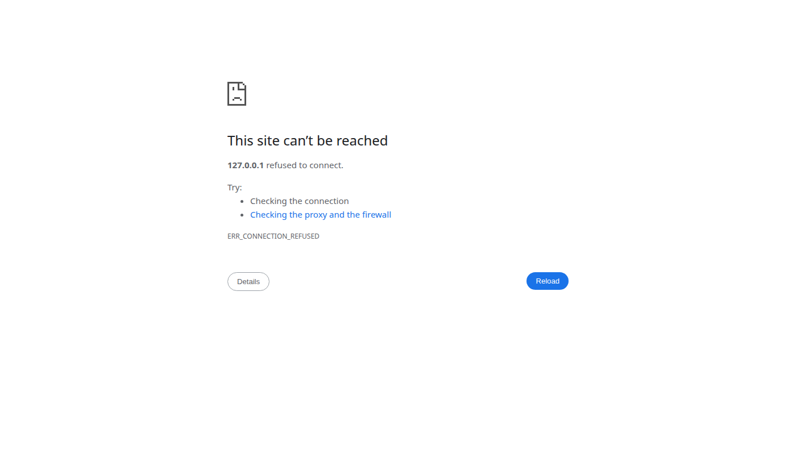
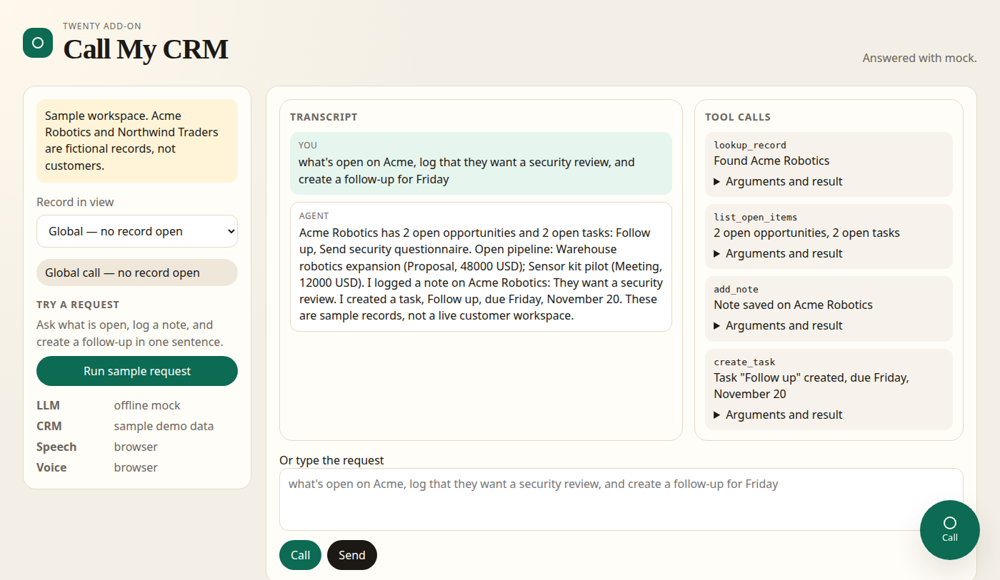
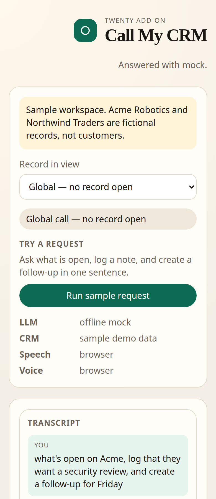

# Call My CRM

Voice front door for a Twenty workspace. Speak or type a request. The agent calls Twenty's own REST API (or the built-in sample workspace), shows the transcript and the tool calls, and speaks the reply.

## What it is for

A forward-deployed engineer uses this kind of loop to wire an agent to CRM actions: look up a record, read what is open, log a note, create a follow-up. A solutions engineer uses the same loop on a company or person record so a seller can talk through the update instead of clicking through forms.

This folder is a demo add-on on a Twenty fork. The sample companies are fictional. It is not a production dialer, not a Teams store app, and not an Agentforce runtime.

## Architecture

```
browser mic or typed text
        │
        ▼
call-my-crm server (Node, no extra packages)
        │
        ├── speech in:  NVIDIA ASR or any Whisper-compatible /audio/transcriptions
        │               browser Web Speech API when no server key is set
        ├── agent:      NVIDIA chat completions (tool calls) at
        │               https://integrate.api.nvidia.com/v1
        │               offline planner when NVIDIA_API_KEY is missing or the call fails
        ├── CRM tools:  lookup_record, list_open_items, add_note, create_task
        │               Twenty REST  /rest/companies|people|notes|noteTargets|tasks|taskTargets
        │               or the in-memory sample workspace
        └── speech out: browser speechSynthesis, or ElevenLabs / a generic HTTP TTS URL
```

The page streams tool calls as newline-delimited JSON. The same agent answers `POST /webhooks/teams`.

Twenty record URLs such as `/objects/companies/<id>` are read by `public/embed.js`, which adds a floating Call button and opens this desk in an iframe. The Twenty React app is left unchanged.

## Run

Docker Compose is the intended run. From this folder:

```bash
cp .env.example .env   # optional; blank values use the offline agent
docker compose up --build
```

Without Docker, Node 22 or newer:

```bash
node --test test/*.test.mjs
node src/server.mjs
```

Open:

- http://localhost:8787 — call desk, including the floating Call button
- http://localhost:8787/record-preview.html — sample company record with the embed button

The desk works with the keyboard if the browser has no microphone. Click **Run sample request** to send:

`what's open on Acme, log that they want a security review, and create a follow-up for Friday`

Acme Robotics and Northwind Traders are sample records. The reply says so. Demo writes stay in memory until the process restarts.

### Point it at a Twenty workspace

In Twenty, create an API key under Settings → Developers → API keys. Then in `.env`:

```bash
CRM_PROVIDER=twenty
TWENTY_API_URL=http://localhost:3000
TWENTY_API_KEY=your-key
```

`TWENTY_API_URL` is the server origin. The client calls `{origin}/rest`. Notes are stored as `bodyV2.markdown` and linked with `noteTargets` (`targetCompanyId` or `targetPersonId`). Tasks use `status: TODO`, `dueAt`, and `taskTargets`.

To open the desk on a real record, pass the id the Twenty page already has:

```
http://localhost:8787/?object=company&recordId=<uuid>&label=Acme
```

Or add the embed script to a page:

```html
<script
  src="http://localhost:8787/embed.js"
  data-object="company"
  data-record-id="<uuid>"
  data-label="Acme"
></script>
```

If `data-record-id` is omitted, the script reads `/objects/companies/<uuid>` or `/objects/people/<uuid>` from the host page.

### NVIDIA and speech

```bash
LLM_PROVIDER=nvidia
NVIDIA_API_KEY=
NVIDIA_BASE_URL=https://integrate.api.nvidia.com/v1
NVIDIA_MODEL=meta/llama-3.3-70b-instruct

STT_PROVIDER=nvidia
NVIDIA_ASR_MODEL=openai/whisper-large-v3
```

`STT_PROVIDER=whisper` uses `WHISPER_BASE_URL` and `WHISPER_API_KEY` against the same `/audio/transcriptions` shape. Leave speech unset and the browser uses the Web Speech API, with the text box when that API is missing.

`TTS_PROVIDER=elevenlabs` needs `ELEVENLABS_API_KEY` and `ELEVENLABS_VOICE_ID`. `TTS_PROVIDER=http` POSTs `{ "text": "..." }` to `TTS_HTTP_URL` and expects audio bytes back. The default is `speechSynthesis` in the browser.

If `LLM_PROVIDER=nvidia` and the request fails, the offline planner still runs the tools and the reply says the offline agent answered. A missing key never gets committed; `.env.example` only has an empty `NVIDIA_API_KEY`.

## Teams webhook

There is no Teams app package. Power Automate, Logic Apps, or an outgoing webhook can POST the message text to this server.

`GET /webhooks/teams` describes the contract. `POST /webhooks/teams` runs the agent.

```bash
curl -s http://localhost:8787/webhooks/teams \
  -H 'content-type: application/json' \
  -H 'authorization: Bearer YOUR_SECRET' \
  -d '{"type":"message","text":"what'\''s open on Acme, log that they want a security review, and create a follow-up for Friday"}'
```

The JSON body accepts `text` or a Bot Framework-style `message.text`. Optional `recordId` and `object` (`company` or `person`) tie the call to a record. The response is a message activity whose `text` is the spoken reply plus an `Actions:` list of tool calls. `toolCalls` is also on the JSON.

Set `TEAMS_WEBHOOK_SECRET` to require `Authorization: Bearer <secret>` or the `x-call-my-crm-secret` header. Leave it empty only on your own machine. The desk has no login of its own, so do not publish port 8787 on an open network when `TWENTY_API_KEY` is set: anyone who can reach it can write notes and tasks with that key.

## Limits

- The offline agent handles lookup, “what’s open”, “log that …”, and follow-ups with a weekday or “tomorrow”. Other phrasing needs the NVIDIA model, which then chooses the same four tools.
- Browser speech recognition depends on the Web Speech API. Headless or locked-down browsers should use the text box or `STT_PROVIDER`.
- Opportunity “open” means the stage is not `CUSTOMER`. Task “open” means the status is not `DONE`. Those are Twenty’s standard values.
- The embed script is a page hook. It is not installed inside Twenty’s navigation.

## Screenshots

Sample record with the floating Call button:



Call desk after the sample request. The transcript and the four tool calls are on the page:



Opening the button shows the same desk beside the record:


The same desk stacked on a narrow viewport. The round Call button stays on wider windows; the in-page Call button remains on a phone:



## Tests

```bash
node --test test/*.test.mjs
```

The tests drive the offline agent, the NVIDIA request shape with a fake fetch, the Twenty REST mapping against a fake `/rest` server, speech provider requests, and the HTTP desk including the Teams webhook.
